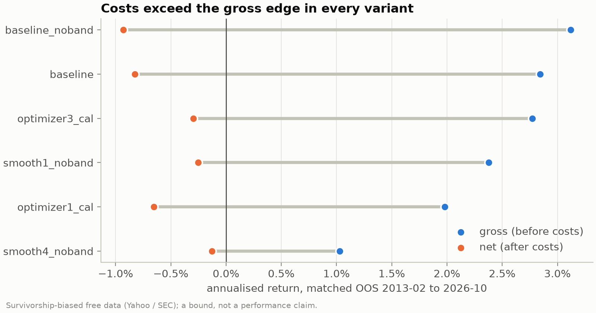

## Introduction

This project replicates and extends the Avellaneda–Lee residual mean-reversion strategy on US equities. I strip out each stock's factor exposure, model the remaining residual as an Ornstein–Uhlenbeck process, and trade its deviations from the mean in a dollar-neutral portfolio. Most of my effort went into making the evaluation honest, so that the results reflect what the strategy would have done and not what a backtest made it look like.

## Method

The pipeline starts from stock returns and computes ETF or PCA residuals. It fits an OU process to each residual path and turns that fit into an s-score signal. The signal feeds a hedged portfolio, built either by a simple rule or by a convex receding-horizon optimizer. Execution is simulated with lag, drift, spreads, impact and borrow costs. Everything is evaluated walk-forward using HAC t-statistics, the probabilistic Sharpe ratio and the deflated Sharpe ratio.

I added two pieces on top of the classical pipeline. The first is a set of neural policies: linear, LSTM and causal conv–Transformer networks that learn positions directly from residual histories, trained end to end through a differentiable allocation and cost model. The second is a pair of C++20 kernels for the OU fit and the backtest, parity tested against the Python reference. Against a fair, vectorized NumPy baseline the OU kernel is only about 2× faster, and a Numba version is faster still, so the main lesson was to batch the work rather than to rewrite it in C++.

## Results

The data cover 16.5M daily observations across 4,186 US equities from 2000 to 2026, built from free Yahoo and SEC data, and the models run from 2010. The 5-day s-score IC is −0.013 (HAC t = −5.4), which is the contrarian direction I expected. The IC covers the whole sample, including the exploration years, so it is not out of sample. However, my assumed costs consume it, and every classical variant lands between −0.1% and −0.9% per year net (Exhibit 1).

Exhibit 1: Annualised gross and net return for each classical variant over the matched out-of-sample period. Every variant has a positive gross edge, and in every variant costs exceed it.
{: .text-muted }

The raw OU forecasts were about 40× too large. After calibrating them online, fitting only on matured outcomes, the median slope came out to 0.025. Turnover control cut trading by about 78%, but much of that saving came from carrying less exposure rather than trading better. Adaptive walk-forward selection overfit, doing worse than every fixed variant.

As a cross-check without the stock-list bias, I ran the same rule, unchanged, on French's 49 industry portfolios over a 1980–1999 holdout. It lost money before costs (−0.89% per year gross, HAC t = −3.46). Industry returns tend to continue rather than reverse, so this is an industry-level check rather than a survivorship-free test of the stock signal; that needs a rerun on data that includes delisted stocks.

The sequence models traded about 60–66% less than a linear policy and beat it by 6–7 pp per year, about half from lower costs and half because the linear policy lost money before costs. They did not beat the classical reference, and the results were unstable from seed to seed.

## Takeaways

None of the studies passed its pre-registered positive-return gate. The stock data only holds companies that are still listed today, so every stock-level figure is survivorship-biased and should be read as a bound, not a performance claim. The repository is meant to show the modeling and how I evaluated it, not to claim alpha.
